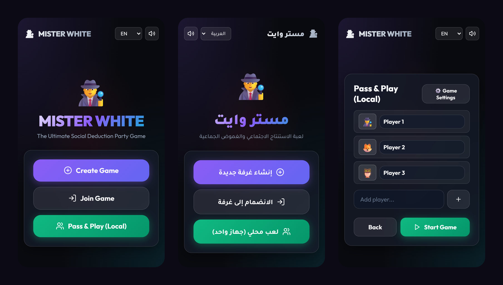

# Mister White

**A real-time multiplayer social deduction party game in English, French and Arabic (RTL), running entirely on Cloudflare's edge.**

[](https://github.com/ahmed-abdelkafi/mister-white/actions/workflows/ci.yml)

**Play it:** https://mister-white.pages.dev



---

## The game

Every player gets a secret word, except two kinds of impostors:

- **Civilians** share the same word (e.g. *Pizza*) and try to unmask the impostors through one-word clues.
- **Undercover** agents get a close but different word (e.g. *Burger*) and don't know they are the odd ones out.
- **Mister White** gets no word at all and has to blend in. If voted out, they get 30 seconds to guess the civilians' word and steal the win.

Rounds alternate between clues, discussion and a vote, until either all impostors are out or they reach parity with the civilians.

## Highlights

- **Online multiplayer over WebSockets.** Each room is a **Cloudflare Durable Object** that owns the game state and drives every phase (role reveal, clues, discussion, voting, ties, sudden death) with server-side timers.
- **Server-authoritative and cheat-resistant.** Roles and words stay on the server; each player only ever receives their own private state, so nothing can be read from the network tab. The full roles are revealed only at game over.
- **Pass & Play mode.** One phone passed around the table, with a "tap and hold" privacy curtain between players.
- **Three languages, including Arabic right-to-left**, with dedicated typography (Outfit, Tajawal) and a shared i18n package used by both the web app and the worker.
- **546 curated word pairs in 3 languages**, stored in Cloudflare D1, plus optional AI-generated pairs through **Workers AI** (Llama 3.1 8B).
- **Forgiving guesses:** accents, case and punctuation are ignored, and one typo is tolerated on longer words.
- **Mobile-first UI** with procedural Web Audio sound effects.

## Architecture

```
Browser (React 19 + Vite, Cloudflare Pages)
   │  WebSocket  /api/room/:code
   ▼
Worker (apps/worker) ── routes /api/*, serves word lists
   │
   ├─ Durable Object "GameRoomDO"  one instance per room: players, phases, timers, votes
   ├─ D1 "mister-white-db"         word pairs (EN / FR / AR)
   └─ Workers AI                   optional new word pairs
```

```
apps/
  web/        React 19 + TypeScript + Vite: screens for every game phase, Pass & Play
  worker/     Cloudflare Worker + GameRoomDO Durable Object + D1 schema and seed
packages/
  shared/     game engine (pure functions: roles, votes, win rules, guess matching) and types
  i18n/       EN / FR / AR messages and RTL helpers
scripts/      word dataset generation
```

The game rules live in `packages/shared` as pure functions, so the same engine runs in the Durable Object and in Pass & Play mode, and is unit-tested on its own.

## Tech stack

| Layer | Technology |
|---|---|
| Front end | React 19, TypeScript, Vite |
| Real time | WebSockets on Cloudflare Durable Objects |
| Back end | Cloudflare Workers |
| Data | Cloudflare D1 (SQLite) |
| AI | Cloudflare Workers AI |
| Hosting | Cloudflare Pages (web) + Workers (API) |
| Quality | Vitest, GitHub Actions |

## Run locally

Requirements: Node.js 22+ and npm.

```bash
npm install
npm run dev:worker   # Worker + Durable Objects + local D1 (wrangler dev)
npm run dev:web      # http://localhost:5173
npm test             # game engine unit tests
```

Set `VITE_WORKER_URL` for the web app when the worker runs on another origin.

### Deploy to your own Cloudflare account

```bash
cd apps/worker
npx wrangler d1 create mister-white-db      # put the printed database_id in wrangler.jsonc
npx wrangler d1 execute mister-white-db --remote --file=./schema.sql
npx wrangler d1 execute mister-white-db --remote --file=./populate_all.sql
npx wrangler deploy
```

Then deploy `apps/web` to Cloudflare Pages (build command `npm run build`, output `apps/web/dist`).

## Tests and CI

`packages/shared/src/__tests__/engine.test.ts` covers role assignment (counts, caps, at least one impostor), an unbiased Fisher-Yates shuffle, vote tallies and ties, win conditions, and fuzzy guess matching in Latin and Arabic script. GitHub Actions runs the tests, typechecks the shared packages and builds the web app on every push and pull request.

## Author

Built by **Ahmed Abdelkafi**, Senior Frontend / Full-Stack Developer.
[Portfolio](https://ahmed-abdelkafi.dev) · [LinkedIn](https://www.linkedin.com/in/ahmed-abdelkafi)
